<h1 align="center">Game Watch</h1>

<p align="center"><em>Two tiny watches. Two whole games. One Christmas morning.</em></p>

<p align="center">
  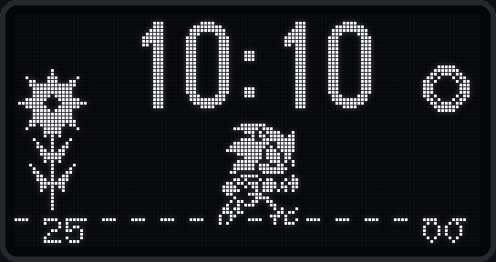
  &nbsp;
  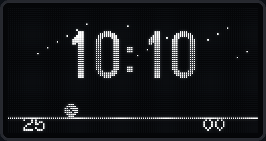
</p>

<p align="center"><sub>Sonic Watch · Metroid Watch · both reading 10:10 on the 25th, as every watch ad legally must</sub></p>

---

Picture it: Christmas morning, 2026. Two small boxes under the tree, one for each kid. Inside each one is a
watch. It tells the time. It has an alarm. And when you press **Game**, the clock face slides away and you're
holding a whole side-scrolling game on your wrist.

Not an app. Not a phone. No account, no ads, no updates nagging at 7 a.m. Just a little black-and-white
screen, five buttons and a buzzer that has *opinions* about ring sounds.

That's the goal of this repo: **two handmade game watches, built as Christmas gifts for my kids.**

- **Sonic Watch** goes to the younger one: run fast, grab rings, bonk Robotnik.
- **Metroid Watch** goes to the older one: land on a hostile planet, find the gear, go back to the places you
  couldn't reach before, and get off the rock before it blows up.

Same hardware, same watch platform underneath, two firmwares. One RP2040 per wrist.

> Built by a dad with a soldering iron, a deadline, and two very specific customers. The QA team is under four
> feet tall and does not accept "it works on my machine."

---

## Status

| Piece | Where it is |
| --- | --- |
| **Hardware** | Working prototype: RP2040-Zero, 1.3" SH1106 OLED, five buttons, piezo buzzer. Power and battery plan still to settle. |
| **Watch platform** (`WatchCore`) | Done. Clock, date, alarm, set screens, sound on/off, screen dimming, time set over USB. |
| **Metroid Watch** | Full campaign playable start to credits. In playtesting on the real watch. |
| **Sonic Watch** | 4 zones, 8 acts, bosses, special stages, all playable. Paused while Metroid gets finished, then it gets the same deep review. |
| **Breach Watch** | New, for a neighbor. A Doom-style first-person shooter: the engine and a test room are in. No deadline. |
| **Testing** | Every push builds both firmwares and runs a room checker, a level checker and a physics bot on GitHub. |
| **Deadline** | December 25. Non-negotiable. Santa does not do extensions. |

---

## Sonic Watch

<p align="center">
  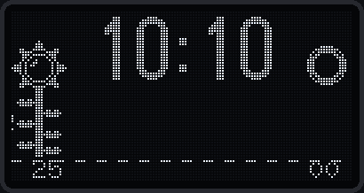
  <br><sub>Clock face → title → Green Hill → Chemical Plant → Special Stage → Egg Wrecker. Real game code, real speed.</sub>
</p>

<p align="center">
  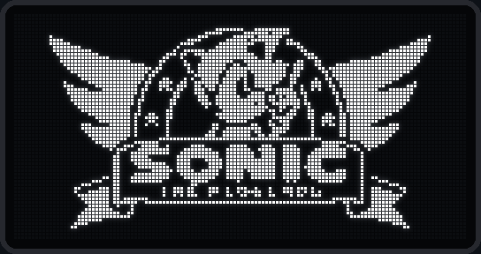
  &nbsp;
  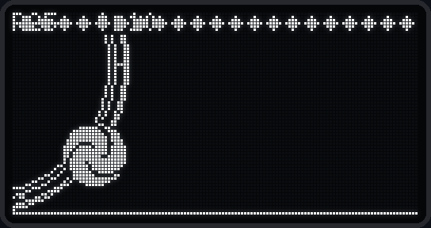
</p>

Sonic, squeezed onto a 128×64 screen without losing the thing that makes Sonic *Sonic*: momentum. He builds
speed, rolls down hills, runs loops, bounces off springs and keeps his spin through a jump. If it doesn't feel
like Sonic, it isn't done.

**4 zones × 2 acts.** A long Act 1, then a short Act 2 that ends with the Egg Wrecker. Finish an act holding
enough rings and you might get pulled into the Special Stage to chase a Chaos Emerald. There are four. Three
is the goal; four is bragging rights.

**Item monitors.** Jump on a TV box (or roll into it) to break it open:

| Monitor | What it does |
| --- | --- |
| Speed Shoes | 8 seconds of full speed. Normal play runs about 17% slower, so this is the real rush. |
| 1-Up | An extra life, with the jingle |
| Shield | Takes one hit for you. Your rings stay put. |
| Invincibility | 15 seconds of sparkles. Enemies pop on contact; spikes and flames can't touch you. |

| Zone | Looks like | Plays like |
| --- | --- | --- |
| Green Hill | Checkerboard dirt, sunflowers, palms | Loops, springs, crabs. The warm-up. |
| Chemical Plant | Pipes and grates | Flame jets, spikes, traps |
| Casino Night | Neon | Pinball bumpers and bounce chains |
| Scrap Brain | Gears and girders | Saws and industrial nastiness |

<p align="center">
  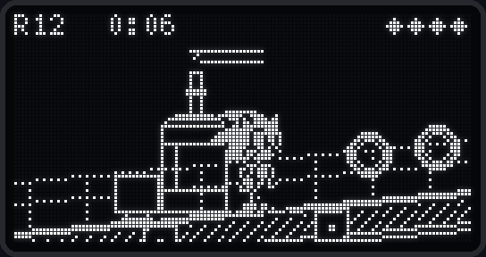
  &nbsp;
  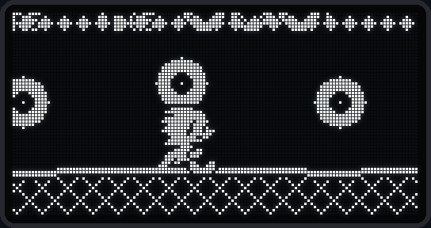
</p>
<p align="center">
  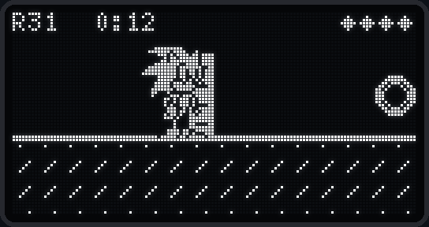
  &nbsp;
  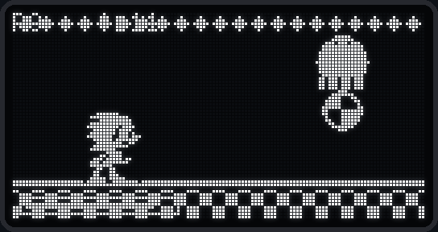
</p>
<p align="center">
  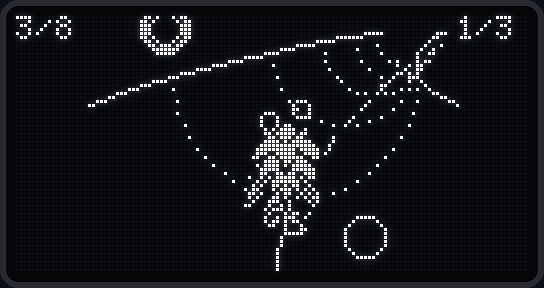
</p>
<p align="center"><sub>Chemical Plant · Casino Night · Scrap Brain · Egg Wrecker · the Special Stage half-pipe</sub></p>

### Sonic controls

| Button | On the clock | In the game |
| --- | --- | --- |
| Left / Right | Adjust − / + | Run. Double-tap to spin-roll, tap again to stand up. |
| Mid | Next field / confirm | Jump (spin momentum carries through) |
| Mode | Set screens (time, date, alarm, sound) | Quit to the clock |
| Game | Start the game | Pause menu |

A spin-roll ends when you tap Left/Right or hit a wall, not when you jump. That's on purpose. Speed is the point.

---

## Metroid Watch

<p align="center">
  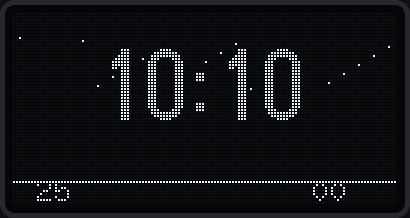
  <br><sub>Clock face → title → story → touchdown on Zebes → Brinstar → Kraid. Real game code, real speed.</sub>
</p>

<p align="center">
  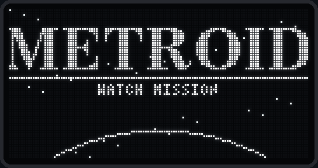
  &nbsp;
  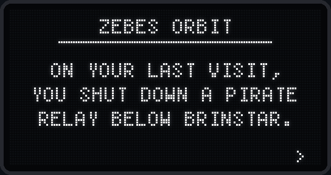
</p>

A real little Metroidvania. Samus lands on Zebes with nothing but a beam and a jump. Behind every locked door
is a reason to come back later: a gap only the Morph Ball fits through, a floor only Bombs can crack, a ledge
only Space Jump reaches.

**29 rooms across Brinstar, Kraid's Lair, Norfair and Tourian.** Morph Ball, Missiles and Bombs wait in Chozo
shrines. Kraid gives you Space Jump. Ridley gives you Ice Missiles, which freeze the flying Rippers into
platforms you can stand on. Beat both bosses and the way into Tourian opens. Destroy Mother Brain, then run for
the ship before the timer hits zero.

<p align="center">
  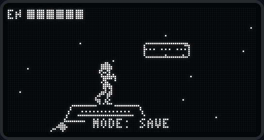
  &nbsp;
  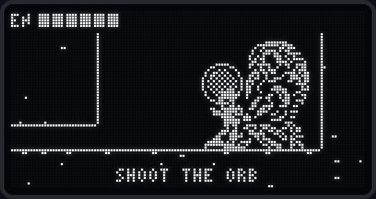
</p>
<p align="center">
  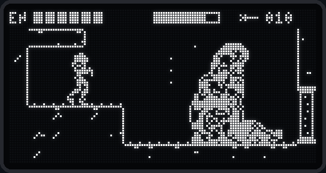
  &nbsp;
  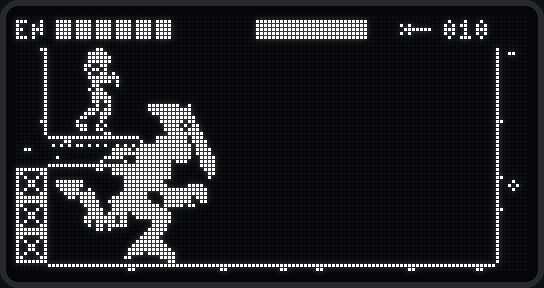
</p>
<p align="center">
  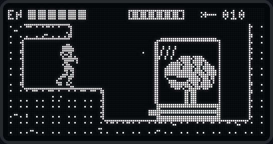
</p>
<p align="center"><sub>The ship (and save pad) · a Chozo shrine · Kraid · Ridley · Mother Brain</sub></p>

It's built for a kid, not a speedrunner:

- **Save anywhere that matters.** The ship and save stations save for real. Pick CLOCK from the pause menu and
  the watch remembers *exactly* where you were. CONTINUE drops you right back in.
- **Saves you can't break.** Every save is written twice, alternating copies, so pulling the battery
  mid-save can't wipe an afternoon of progress.
- **Stuck? Look at the GOAL tab.** It tells you the next thing to do in plain words.
- **Easy Mode**, one press away: every hit costs one energy, spikes and lava just send you back, and the escape
  timer gets extra time.
- **The map remembers.** Rooms you've explored show up, and rooms that still hide an item get a dot.

<p align="center">
  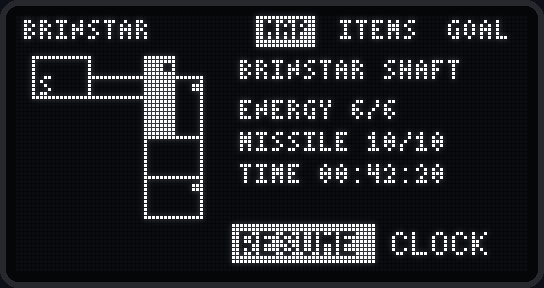
  &nbsp;
  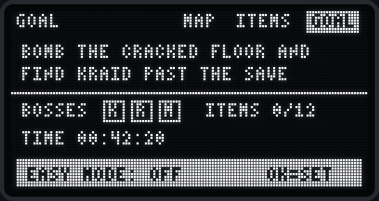
</p>
<p align="center">
  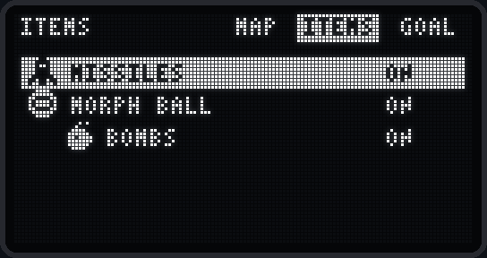
</p>
<p align="center"><sub>MAP · GOAL (with Easy Mode) · ITEMS, where any upgrade can be switched off</sub></p>

### Metroid controls

Five buttons today. A sixth is coming: it becomes a proper Down, and Mode goes back to being cancel/exit.

| Button | On the clock | In the game |
| --- | --- | --- |
| Left / Right | Adjust | Move (hold to run; a running jump somersaults) |
| Mid | Next field | Jump. Press again in mid-air to double jump. Stands you up out of the ball. |
| Mode | Set screens | Down: crouch, press again to roll into the Morph Ball. Saves on a save pad. **Hold it to pause.** |
| Game | Start the game | Fire. In the ball, drop a bomb. |
| Mode + Game | | Tap: swap beam / missiles · Hold: pause |

Pause menu: **MAP / ITEMS / GOAL**, then RESUME or CLOCK (CLOCK suspends the game exactly where you are).

There's a hidden test room too: hold **Left + Right** on the title screen. Every item, every enemy, every boss,
and a frame-time readout in the corner.

---

## The hardware

| Part | What |
| --- | --- |
| Brain | Waveshare **RP2040-Zero** (dual Cortex-M0+, 2 MB flash) |
| Screen | **1.3" SH1106 OLED**, 128×64, I²C at 800 kHz |
| Buttons | Five: Left, Mid, Right, Mode, Game |
| Sound | Piezo buzzer. Bleeps, bloops and boss music. |
| Clock | Software clock, set from the computer over USB when you flash |

Pins, wiring and the gory details: [docs/HARDWARE.md](docs/HARDWARE.md).

Fun fact: at the stock 400 kHz I²C clock, just *sending the picture to the screen* ate the whole 30 FPS frame
budget. Doubling the bus to 800 kHz took frames from ~33 ms to ~19 ms, measured on the real watch. Free speed.

---

## Put it on a watch

You need [`arduino-cli`](https://arduino.github.io/arduino-cli/), the Earle Philhower RP2040 core and the U8g2
library. Full setup in [docs/FLASH.md](docs/FLASH.md).

```bash
./scripts/flash.sh sonic_watch      # the younger kid's watch
./scripts/flash.sh metroid_watch    # the older kid's watch
```

Flashing also sets the clock from your computer. Plugged in later and the time drifted? `./scripts/settime.sh`.

On the watch, **Mode** on the clock face opens the set screens: time, date, alarm, and SOUND on/off. Sound off
silences the games; the alarm still rings, because a silent alarm is just a light show.

---

## How it gets tested (a robot plays it first)

Kids find softlocks the way water finds cracks. So the games get played by machines before they get played by
people:

- **Simulators.** The real game code compiles on a PC against stand-in hardware, so both games run with no
  watch attached, at thousands of frames per second.
- **Room and level checkers.** Metroid's checker walks every room at every upgrade stage: can you get
  everywhere you should, and can you always get back to a save? Sonic's checker enforces the level rules.
- **The physics bot.** For Metroid, a bot really *plays*. It searches about 11,000 spots with the actual
  physics and real button presses (jumps with many timings, double jumps, rolls, bomb jumps, shots), and
  confirms every room the checker promises is truly reachable, with a way home from every one. It has already
  caught a perfect double jump escaping a shrine early. That got fixed before any kid found it.
- **On the watch itself.** Over USB the watch takes fake button presses (`P <buttons> <ms>`) and reports its
  frame times (`F`), so performance gets measured on the real hardware, not guessed.
- **GitHub Actions** builds both firmwares and runs all of the above on every push.
- **These screenshots and GIFs** come straight from the simulators: `./tools/readme_shots.sh` rebuilds every
  picture and `./tools/readme_gifs.sh` re-records both demo reels from the current code.

```bash
./tools/metroid_test/build.sh && ./tools/metroid_test/out/check && ./tools/metroid_test/out/bot
./tools/sonic_test/build.sh   && ./tools/sonic_test/out/check
./tools/breach_test/build.sh  && ./tools/breach_test/out/check
```

---

## Design rules

1. **It's a watch first.** The clock is always one button away, and the game suspends cleanly when you leave.
2. **Feel beats features.** Sonic has to feel like Sonic. Samus has to feel like Samus. Tiny screen, no excuses.
3. **Kid-proof.** No softlocks, no lost saves, a plain-words hint when you're stuck, and an easy mode that
   doesn't feel like a punishment.
4. **Every gate has a reason.** In Metroid, every blocked path is a promise you'll come back with the right item.
5. **Test it like a bot, then hand it to a kid.**

---

## Repo layout

| Path | What lives there |
| --- | --- |
| `libraries/WatchCore/` | The shared watch: buttons, clock, alarm, set screens, sound, dimming, USB time set |
| `sonic_watch/` | Clock face + Sonic |
| `breach_watch/` | Clock face + Breach, a first-person shooter (engine, art and the test room) |
| `metroid_watch/` | Clock face + Metroid (world in `metroid_world.h`, design notes in the folder) |
| `scripts/` | `flash.sh` (build + upload + set the clock), `settime.sh` |
| `tools/` | Simulators, checkers, the physics bot, the screenshot script |
| `docs/` | Platform, hardware, software, flashing, adding a game |

**Docs:** [Platform overview](docs/PLATFORM.md) · [Hardware](docs/HARDWARE.md) ·
[Software design](docs/SOFTWARE.md) · [Flash / build](docs/FLASH.md) · [Adding a game](docs/ADDING_A_GAME.md)

---

<p align="center"><sub>
A homemade, not-for-sale fan project: a gift from a parent to their kids. Sonic the Hedgehog is a trademark of
SEGA; Metroid is a trademark of Nintendo. Neither is affiliated with this, and both made the games that made
us want to build it.
</sub></p>
