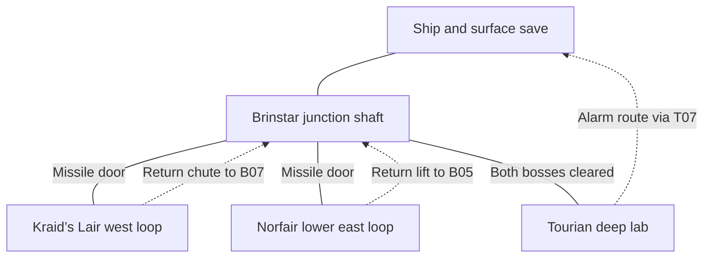
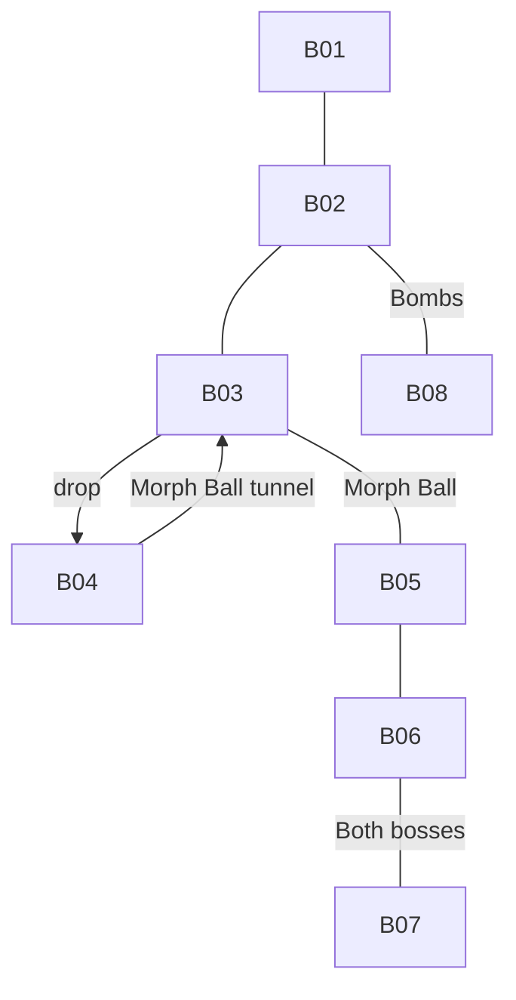
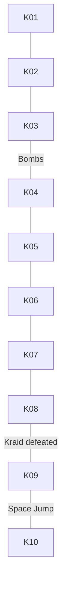
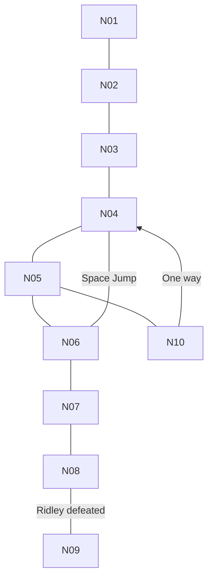
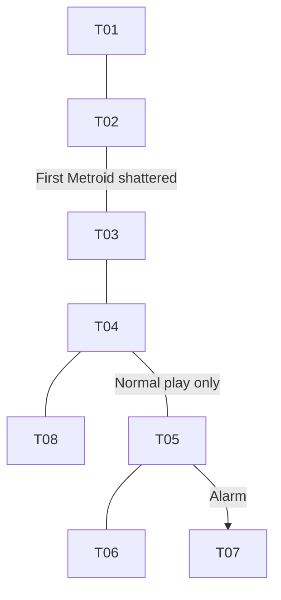

# Metroid Watch Game Design Document

**RP2040 watch · Design Revision 5**

Samus returns to Zebes when a shut-down Pirate relay broadcasts her old distress code. She explores two boss routes in either order and unlocks Tourian. After destroying Mother Brain, she races back to her ship. The game is a side-view adventure for a 128 × 64 black-and-white display and five physical buttons.

The map has 36 connected rooms across four zones. Brinstar’s shaft links Kraid to the west, Norfair to the lower east, and Tourian beneath them. The camera scrolls through larger rooms. The emergency shaft rises beside the ship.

## World layout



Labeled links show the gates. Dotted arrows show one-way returns. The zone notes describe relative direction and depth.

## Playtime targets

| **Zone** | **Rooms** | **Practiced run** |
| -------------------------- | ----------- | ------------------- |
| Brinstar | 8 | 8 min |
| Kraid’s Lair | 10 | 11 min |
| Norfair | 10 | 12 min |
| Tourian including escape | 8 | 14 min |
| Total | 36 | 45 min |

Target about 45 minutes for a practiced ship-to-ship clear and 75–90 minutes for a first playthrough. These are playtest targets. The practiced route assumes the player knows the map and collects the four tanks on the main routes. All eight missile tanks are available in one run.

## Controls and core play

Explore a room, read its hazards or route clues, and decide whether to fight, slip past, or come back with an upgrade. Keep combat horizontal and use jumps to bring enemies and weak points into the line of fire.

| **Input** | **Standing or airborne** | **Morph Ball** |
| -------------- | --------------------------------------------------------------------------- | -------------------------------------------- |
| Left / Right | Move and turn. Hold to keep running. Steer in the air. | Roll in either direction. |
| Up | Jump; press again in mid-air to double jump. With Space Jump, keep pressing to keep somersaulting. | Unused by itself. |
| Down | Fire the current weapon. At a save pad, interact when the prompt appears. | Drop a bomb if enabled. |
| Menu tap | Cycle Gun → Missiles → Morph Ball → Gun. | Return to Gun when there is room to stand. |
| Menu hold | Pause and open the Start menu. | Pause and open the Start menu. |

### Tap and hold

A tap cycles on release. A hold opens the Start menu after about 350 ms. Consume that press through release, then accept a fresh Menu tap to resume. Wait for buttons to release before accepting gameplay input again. Freeze the scene and its timers while the Start menu is open.

Skip modes that are unacquired or disabled. The gun position is always available. Empty missiles stay in the cycle and Down gives a dry-fire cue. If Samus taps to stand in a low tunnel, keep Morph Ball active and flash its HUD icon. A fresh tap can stand up once there is clearance.

Down fires one shot per press. Buffer early jump presses briefly and give the player a short grace window after a ledge. Permit Left or Right together with Up or Down so the player can run, jump, and fire.

### Movement and damage

The jump rises about 45 pixels (twice Samus's height) and the double jump adds about 28 more, so one jump climbs a 4-tile ledge and a double jump about 7 tiles. Level geometry is checked against those numbers. Preserve horizontal direction and momentum during morphing. Ordinary enemy contact takes 1 energy and grants a brief recovery window.

Start with 6 energy. Lava and spikes take 1 energy and return Samus to the latest safe footing in the room. At zero energy, use the last permanent save or the escape checkpoint. Scroll within larger rooms and give the player safe footing and a visible approach on doorway entry.

The HUD briefly identifies the current mode after each tap. Enabling Ice Missiles changes the missile type within the same mode. Disabling Space Jump leaves the normal jump available.

## Start menu and opening

The Start menu opens on Items. Left and Right switch tabs. Tap the side Menu button to close the menu and resume at the same point.

**Start menu mockups.** Items shows ON and OFF for acquired gear. The Norfair map shows player, save, and known exit markers. Mission shows the active objective, boss progress, tank count, elapsed time, and Save & Clock.

The Start menu shows inventory toggles, one zone map, and mission progress on separate screens.

| **Tab** | **Controls and contents** |
| --------- | ------------------------------------------------------------------------------------------------------------------------------------------------------------------------ |
| Items | Up moves the selection. Down toggles Missiles, Morph Ball, Bombs, Ice Missiles, or Space Jump. Show ON or OFF for acquired gear. Newly acquired items start enabled. |
| Map | Open on the current zone. Up and Down browse zones. Fill the current room, mark known saves with S, and mark a seen exit with ?. Keep undiscovered rooms off the map. |
| Mission | Show the current objective, boss clears, missile tanks collected, and run time. Down activates Save & Clock and suspends the game at the current position. |

Disabling active missiles selects Gun. Disabling Morph Ball while rolled up stands Samus and selects Gun if she has clearance. In a tunnel, retain the setting and display NEED ROOM. Bombs require Morph Ball. Ice Missiles require the missile launcher. Each child toggle retains its preference while its parent is disabled. The Power Beam is always enabled.

### Opening transmission

On a new game, show three short panels. Down advances and lands after the final panel. Menu skips to the landing. Continue loads directly into play. Samus follows her own distress code from the old relay to Tourian, where the signal leads to Mother Brain.

#### ZEBES ORBIT

```text
ON YOUR LAST VISIT,
YOU SHUT DOWN A PIRATE
RELAY BELOW BRINSTAR.
```

#### INCOMING SIGNAL

```text
THE RELAY IS LIVE AGAIN.
IT IS BROADCASTING
YOUR OLD DISTRESS CODE.
```

#### MISSION

```text
LAND AT THE OLD SITE.
TRACE THE SIGNAL.
FIND OUT WHO SENT IT.
```

## Equipment energy and ammo

| **Equipment** | **Acquisition** | **Behavior** |
| ------------------ | ---------------------------- | ------------------------------------------------------------------------------------------------------------------------------------------------------------------------------------------------------ |
| Power Beam | Starting weapon | Unlimited horizontal shots. Handles common enemies, Kraid’s weak point, and Mother Brain after her glass breaks. |
| Morph Ball | Brinstar B03 | Tap Menu to cycle into Morph Ball. Roll through low tunnels to reach the launcher. |
| Missile Launcher | Brinstar B05 with tank #1 | Costs one round per shot. Opens red doors and damages Ridley and Mother Brain’s glass. A hit permanently opens the door in the current save state. |
| Bombs | Kraid’s Lair K03 | Down in ball form drops a short-fuse bomb. Unlimited with one live bomb at a time. Opens cracked floors and dislodges attached Metroids. |
| Space Jump | Kraid defeat at K08 | Unlimited mid-air jumps while somersaulting, and the somersault damages small enemies on contact and breaks marked Space Jump blocks. Hazards and boss attacks still damage Samus. (Replaces Space Jump; the double jump is part of Samus's base suit.) |
| Ice Missiles | Ridley defeat at N08 | Adds an Ice toggle to the missile slot. One ice hit freezes a Metroid and a second shatters it while frozen. Switching Ice off gives regular missiles. Both types open red doors and work on bosses. |

### Eight missile tanks

Each tank adds five to capacity and current ammo. Tanks #1, #3, #5, and #6 auto-collect on the main route and give 20 capacity. The first includes the launcher. Hidden tanks #2, #4, #7, and #8 raise the maximum to 40.

### Two Energy Tanks

Each Energy Tank permanently adds 2 to maximum energy and refills health to the new maximum. Samus starts at 6, reaches 8 after either tank, and reaches 10 with both. Energy Tank #1 sits on a side ledge in K06 and #2 sits on a side shelf in N03. Both are optional and accessible with the base jump in either boss order. Bosses and the escape remain beatable at the starting capacity.

### Refills and recovery

Save stations refill to the current energy and missile limits. Both branches have pre-boss refills, and Tourian has two.

Ridley and Mother Brain’s glass take six missile hits each. Collect #5 before Norfair’s bypass split and #6 after it rejoins, guaranteeing 15 capacity before a Ridley-first fight. The first Metroid takes two shots and opens the route onward.

Leave a retreat to a refill from every missile gate and from both missile-dependent boss arenas.

## Brinstar

A surface approach leads east into the Brinstar Shaft, the spine of the zone and the road home. The shrine at the top of the shaft holds the Morph Ball; the ball tunnels at the bottom lead on to the Missile Launcher and the junction, where Samus chooses either boss branch.



| **ID** | **Room** | **W × H** | **Shape and traversal** |
| -------- | ----------------------- | ----------- | -------------------------------------------------------------------------------------------------------------------------------- |
| B01 | Ship and Landing Site | 2×2 | Ship and starting save (the primary save until Kraid's K07). East to B02. The shaft vent beside the ship receives the alarm exit from T07. |
| B02 | Surface Path | 2×1 | Rocky shelf. West to the ship, east into the top of B03. Show the cracked floor and tank #2 below before Samus has Bombs. |
| B03 | Brinstar Shaft | 1×4 | Doors near the top: west to B02, east to the shrine, across a 2-tile gap. Shelves step down the middle and climb back with the base jump and double jump. At the bottom a ball-sized hole in each wall: east returns from the shrine, west goes on to B05. Both are visible before the Morph Ball. |
| B04 | Morph Ball Shrine | 1×3 | One way in: the door ledge drops 13 tiles (deeper than a double jump) into the statue's chamber. Shoot the Chozo orb, take the Morph Ball, and roll out through the west tunnel into the bottom of B03. |
| B05 | Missile Room | 2×2 | Rolled into from the bottom of B03 (east duct, top right). A step and a long shelf lead down to the floor and back up. The Missile Launcher (with tank #1) sits in a Chozo statue's hands. East door to B06. |
| B06 | Junction | 2×2 | Hub. Blue door (upper west) back to B05, climbed via a step and a ledge. Missile doors west to K01 and east to N01. Locked hatch down to B07. |
| B07 | Tourian Approach | 1×1 | Landing above the Tourian hatch. K09 drops here from the west. Hatch to T01 requires both bosses. (Not built yet.) |
| B08 | Buried Alcove | 1×1 | Tank #2 below B02. Bomb down through the seam from B02. Put a step or short ledge beneath it so Samus can jump back out. (Not built yet.) |

### Item rooms and backtracking

- Every major item (Morph Ball, Missiles, Bombs, Space Jump, Ice Missiles) sits in a Chozo statue's hands inside an orb that Samus shoots open, and gets the full pickup ceremony. Missile and Energy Tanks are low-key.
- Where possible, the room an item is found in can only be left by using that item (the Morph Ball shrine is the model).
- Samus can always get back to the ship from anywhere she can reach with the gear she has. The ship is the save point until the boss-branch saves. One-way drops are fine only if the way they lead also loops home.
- Before the Morph Ball, every required passage fits Samus at full height (no crouch-only gaps).
- `tools/metroid_test/out/check` checks these rules on the real room data.

## Kraid’s Lair

The upper passage heads west to Bombs. The lower route turns back east toward the boss. The post-boss chute reconnects to Brinstar above the Tourian hatch.



Footprints are width × height in play windows. Cross-zone links appear in the room descriptions.

| **ID** | **Room** | **W × H** | **Shape and traversal** |
| -------- | -------------------- | ----------- | ---------------------------------------------------------------------------------------------------------------------------------- |
| K01 | Lair Entrance | 1×1 | Entrance from Brinstar’s west missile door. Continue west to K02 and keep the east door back to B06 open. |
| K02 | Spike Hall | 2×1 | Westbound gallery to K03. Use low spike gaps and a Zoomer. Give the first Swipe Pirate a flat patrol lane. |
| K03 | Bomb Chamber | 1×1 | Safe standing alcove at the west end of the upper loop. Pick up Bombs above the first cracked floor to K04. |
| K04 | Cracked Descent | 1×2 | Bomb the floor before the descent. Use staggered steps to make the shaft climbable back to K03 with a normal jump. |
| K05 | Lower Cache | 2×1 | Automatic tank #3 on the main path. The lower gallery turns east toward K06. |
| K06 | Lower Tunnels | 2×2 | Low ducts alternate with standing pockets on the reversible climb. Energy Tank #1 sits on a side ledge before K07. West to K05. |
| K07 | Kraid Save | 1×1 | Save and refill at the top of the lower climb. Enter Kraid to the east. |
| K08 | Kraid | 2×2 | Arena east of the save. Beam-accessible weak point. Victory gives Space Jump and opens the east door to K09. |
| K09 | Service Chute | 1×1 | Space Jump opens a one-way outlet into B07. Keep the west route through cleared K08 for returning to the cache. |
| K10 | Space Jump Cache | 1×1 | Tank #4 behind a separate Space Jump block below K09. Provide a return ledge to the chute without taking its one-way exit. |

## Norfair

Descend on the west side, cross the lower hot corridor, then climb to the upper save. Ridley’s lift exits at B05. The optional bypass skips the Bolt Pirate corridor after tank #5.



Footprints are width × height in play windows. Cross-zone links appear in the room descriptions.

| **ID** | **Room** | **W × H** | **Shape and traversal** |
| -------- | ------------------ | ----------- | ------------------------------------------------------------------------------------------------------------------------------------------- |
| N01 | Norfair Entrance | 1×1 | Missile door from B06 at the upper west edge. Keep it open in both directions once shot. Descend to N02. |
| N02 | Lava Crossing | 2×1 | Wide lava lane with a safe midpoint shelf and a visible landing. Lower outlet goes to N03. |
| N03 | Lower Shaft | 1×3 | Base-jump ledges lead to Energy Tank #2 on a side shelf. N02 above, east exit to N04 at the lower landing. |
| N04 | Missile Ledge | 2×1 | Auto-collect tank #5 before the route splits. East to N05 or high Space Jump bypass to N06. The return drop from N10 lands here. |
| N05 | Hot Corridor | 2×2 | Bolt Pirate guards the lower east lane. Climb to N06 or take a smaller overhead route west to N10. Both climbs work with the base jump. |
| N06 | Upper Cache | 1×1 | Auto-collect tank #6 after the main climb and bypass merge. South to N05, east to N07, and back across the opened bypass to N04. |
| N07 | Ridley Save | 1×1 | Save and refill at the upper east landing. Descend to Ridley. The path remains open back from the arena. |
| N08 | Ridley | 2×2 | Arena below the save. Maintain a climb back to N07 at zero ammo. Victory grants Ice Missiles and unlocks the east path to N09. |
| N09 | Return Lift | 1×3 | Lift rises outside the east side of the loop, then returns one-way to B05. Return to N08 remains available before committing to the lift. |
| N10 | Hidden Ledge | 1×1 | Reach tank #7 from N05 using the base jump. Return to N05 or take a one-way drop to N04. |

## Tourian

Enter from the upper right and work west through the lab. The last save sits over Mother Brain. The alarm turns the approach into a short return through T05 and up to the ship.



Footprints are width × height in play windows. Cross-zone links appear in the room descriptions.

| **ID** | **Room** | **W × H** | **Shape and traversal** |
| -------- | -------------------- | ----------- | ---------------------------------------------------------------------------------------------------------------------- |
| T01 | Tourian Entry Save | 1×1 | Save and refill below B07. Leave the route back to Brinstar open. Continue down to T02. |
| T02 | First Metroid | 1×1 | Teaching room. The west door to T03 opens after freeze and shatter. Keep the upper retreat to T01 available. |
| T03 | Metroid Nest | 2×2 | Two Metroids in the main gallery. A lower run-and-jump route reconnects to the west exit and lets Samus slip past. |
| T04 | Turret Corridor | 2×1 | Westbound turret lane. Branch down to T08 and continue west to the final save. |
| T05 | Final Save | 1×1 | Refill before the fight below. The west hatch to T07 opens on alarm. The east route to T04 closes during the escape. |
| T06 | Mother Brain | 2×2 | Chamber below T05. Keep the climb to the refill and escape landing open before, during, and after the fight. |
| T07 | Emergency Shaft | 1×4 | West of the lab and directly beneath the ship. Alarm-only route. Climb on base jumps and exit one-way at B01. |
| T08 | Hidden Cache | 1×1 | Tank #8 on a detour from T04. Return to the turret corridor before the alarm. |

## Progression and recovery rules

The progression review checked both boss orders and a clear with all eight missile tanks. In 269 reachable room and progression combinations, setting missiles to zero still left a route to a refill before the alarm. The room geometry and encounter checks below carry those rules into the playable build.

### Ability gates

Grant Morph Ball in the B04 shrine before the ball tunnels at the bottom of B03. Grant Bombs in K03 before the first bomb floor. Both B06 branch doors take one missile hit and then stay open in both directions. Kraid’s weak point works with the Power Beam. Boss victories award Space Jump or Ice Missiles in the same state update that opens their exits.

Require both boss clears at the Tourian gate. Kraid’s shortcut enters B07 above the locked gate, and Ridley’s lift enters B05. Keep both boss arenas traversable on a return trip so their shortcuts and side tanks remain reachable.

### Ammo and equipment recovery

| **At zero missiles** | **Required route** |
| ---------------------- | --------------------------------------------------------------------------------------------------- |
| Ridley N08 | Climb back to N07 to refill. Keep this route open throughout the fight. |
| First Metroid T02 | Return up to T01. Shattering the Metroid unlocks the forward door, and the route back stays open. |
| Mother Brain T06 | Climb back to T05 to refill during the fight. The same route starts the escape. |

Keep the Start menu available while Samus is rolled up or latched. A player can re-enable missiles, Ice Missiles, Morph Ball, or Bombs as needed. If Samus has insufficient headroom, defer standing and keep Morph Ball enabled. A latch leaves movement and gear inputs available so a bomb can dislodge the Metroid.

### Route clues

Give bomb floors a jagged seam, Space Jump blocks a diagonal slash, and missile doors a double bar. Show each hidden route’s clue from an adjoining room on the main path.

### Geometry checks in the build

Use the actual collider to climb back from forced drops and verify room exits in both directions where marked. Reach N10 on a Ridley-first run with the base jump. Allow enough freeze time for a second missile to hit from the farthest normal firing position. Verify the 40-second escape using basic movement and one energy with optional gear disabled.

## Enemies and Space Pirates

Use each enemy’s silhouette and one clear windup to signal the attack on the watch display. Introduce the two Pirate variants in separate encounters before using more than one threat in a room.

| **Enemy** | **Movement and attack** |
| -------------- | --------------------------------------------------------------------------------------------------------------------------------------------------------------------------------------------------------------------------- |
| Zoomer | A low, spiked crawler that paces the surface and turns visibly at edges. Jump over it or fire into its lane. |
| Skree | A ceiling diver. Show a narrow body with folded wings, then flare the wings before diving. The sprite still needs a readability pass. |
| Ripper | A wide, armored flier that glides horizontally in a fixed lane. Use its silhouette and steady motion to distinguish it from the Skree. |
| Turret | The barrel flashes before it fires horizontally. Cross its lane between shots. |
| Metroid | Hovers, then dives. An Ice Missile freezes it. A second hit shatters it before thaw. A latched Metroid drains energy while Samus can still move, morph, and bomb to dislodge it. A jagged outline marks the frozen state. |
| Swipe Pirate | Walks back and forth between patrol points. When Samus comes close, it raises a hooked forearm, swipes in melee range, then recovers and resumes patrol. |
| Bolt Pirate | Guards a lane, extends its forearm as a firing tell, and shoots one slow horizontal bolt at a time. Give Samus time to jump over the bolt or move to another height. |

**Space Pirate art reference.** The two poses show the sloped head, jointed legs, long hooked forearms, and the transition from guard to an extended claw. The Pirate is 23 pixels tall next to a 22-pixel Samus.

Both Pirate variants use the humanoid mantis design. Give Swipe a raised claw for its close-range windup and give Bolt an extended claw with a brief muzzle cue. The poses above establish the body shape and scale.

## Boss encounters and escape

### Kraid

Kraid braces, sends a low volley across the arena, then exposes his belly at the height of a normal jump shot. Start with six beam hits, with enough time for one clean hit in each opening. Missiles can also damage the weak point. Victory grants Space Jump immediately and opens the exit. The safe return to K07 remains available.

### Ridley

Ridley winds up high, swoops along a clear path, lands, and exposes a weak point. Keep the windup and landing distinct in silhouette. Start with six missile hits. The landing window permits one or two shots depending on timing. Run under the high approach or jump the low pass. Victory awards Ice Missiles and opens the return lift together. Keep the retreat to N07 available during the fight.

### Mother Brain

The first phase puts a glass barrier between Samus and Mother Brain. Six missile hits crack it while a floor turret fires in a timed lane. Show crack progression at a glance. Leave the climb to T05 open while the turret fires. Once the glass breaks, standard beam shots can finish Mother Brain. Start at eight beam hits for the exposed phase.

### Timed escape

On the final hit, commit Mother Brain’s defeat, the alarm phase, the open hatch, and a safe T06 checkpoint together. Start the 40-second countdown when Samus regains control. From T06 she climbs back to T05, takes the hatch to T07, and exits at B01. Lock the T05-to-T04 route during the alarm and preserve the route to the ship.

The escape climb uses normal running and jumping. Boarding the ship records the clear time and tanks. Death or a time-out restarts the alarm with post-fight energy and ammo. Save & Clock preserves the in-progress countdown. Build in time to recover from a missed jump on a clean route.

All hit counts, windups, jump distances, and the escape time are initial tuning values. Watch-button playtests set the final windows.

## Saving and clock mode

### Permanent save stations

There are five stations at B01, K07, N07, T01, and T05. Stand on the pad, wait for the save prompt, and press Down. The station refills energy and ammo and commits the respawn point, gear and toggles, collected Energy and Missile Tank IDs, map discovery, boss clears, open gates, and time. The boss routes allow a return to save. Record an opened missile door and its ammo cost together. Save the boss defeat with its reward and shortcut flag.

A normal death restores the last station’s state. Derive maximum energy from the saved Energy Tank IDs. A tank increases capacity only once per run state. Keep accrued play time across deaths. Start a new game with an automatic ship checkpoint.

### Suspend and resume

Save & Clock in the Mission tab writes a suspend snapshot and returns to the watch face. It records the room, position and movement, mode, equipment toggles, health, ammo, collected tank IDs, map discovery, progress flags, and encounter state. During the escape it also records the remaining countdown and the alarm checkpoint.

Continue restores the latest valid suspend snapshot. With no valid suspend, load the escape checkpoint during the alarm or the latest permanent save during normal play. Keep a pre-finale snapshot at T05 when entering T06 for the first time. After a clear, let the player return to that snapshot for missed items while retaining the recorded result.

A suspend snapshot preserves play without changing the death respawn point. Invalidate it on death, a new run, or a newer save. Use atomic or two-copy writes with versions and checksums. Keep the screen awake during active play. Entering clock mode suspends the encounter and both timers.

### Title and results

| **Screen** | **Contents and actions** |
| -------------- | ------------------------------------------------------------------------------------------------------------------------------------------- |
| Title | METROID wordmark, Continue, and Start. Continue appears after a valid save exists. Start asks for confirmation if it would replace a run. |
| Gameplay HUD | Energy at left and current mode with missile count at right, in the top eight rows. During escape, give the countdown the most space. |
| Results | Clear time, missile tanks out of eight, Energy Tanks out of two, and best clear time. Return to the title or clock. |

Start the run timer when Samus first becomes controllable. Count active play and failed attempts. Freeze the run timer in the Start menu and in clock mode. Stop it when Samus touches the ship’s boarding pad after Mother Brain. Store the result independently of the current save so a new run preserves the best time.

## Screen art and camera

Render to a 128 × 64 one-bit display. The top eight rows hold the HUD. Use pure black and white with sharp source pixels. Samus is 22 pixels tall. Her reference stance uses a rounded suit helmet, a low arm cannon, a narrow waist, and bent knees. The Morph Ball remains about 7 pixels across.

**Screen art references.** The title mockup centers the METROID wordmark over Continue and Start. The Brinstar gameplay mockup shows 22-pixel Samus above a rocky ledge and an overhang that continues beyond the frame.

The Brinstar study uses the 22-pixel reference pose at its native game scale. The title and gameplay frames are both 128 × 64 pixels.

### A window onto the world

Treat the display as a moving viewport into a connected map. Use smooth horizontal and vertical scrolling within larger rooms. Let cliffs, tunnels, shafts, and overhangs extend past the viewport edges. Keep doorways as room boundaries for the map and save system.

Keep Samus somewhat behind the camera center in her direction of travel so the player can see the next ledge or incoming shot. Follow height when she climbs or drops. Clamp the camera at room bounds and avoid recentering on every ordinary jump. At a doorway, position the new view on safe footing with the next threat in view.

### Art and sound

Use irregular bright outlines and sparse rock texture in Brinstar. Give Kraid’s Lair spiked stone, Norfair bright lava edges, and Tourian straight metal lines. Reserve the strongest contrast for characters, hazards, and shots. Treat the new 22-pixel pose as the reference for idle, run, aim, jump, Morph Ball, and Space Jump art.

Use short optional buzzer cues for pickups, doors, damage, saves, and the escape alarm. Pair each important cue with visible feedback.

## Implementation and playtest

### Production order

Start with the 1-bit, 1,024-byte framebuffer and a fixed gameplay tick. Represent rooms as world-coordinate tile and collision data with bounds, doors, encounters, pickups, and upgrade gates. Keep camera coordinates separate from player and enemy coordinates. Use stable IDs for rooms, gear, bosses, and map discovery.

Build Brinstar from the landing through the missile launcher. Test scrolling across a large room, weapon cycling, Morph Ball, the three Start tabs, and a save. Build and test both boss branches, then Tourian, the escape, and results.

### Acceptance checks

**Controls.** Check taps and holds on physical buttons at the threshold, including held-button release, empty missiles, disabling the current mode, and trying to stand inside a low tunnel.

**Map and camera.** Cross a room larger than one viewport in both axes. Verify look-ahead reveals safe landings, and check that the map marks discovered rooms and save stations across zone changes.

**Enemies.** Verify that a Swipe Pirate patrols, telegraphs, and uses a close-range swipe. Verify that a Bolt Pirate fires a slow bolt along its lane and that Samus can see it early enough to jump. Test normal, frozen, and latched Metroid states.

**Progression.** Finish both boss orders. Confirm the 15-missile Ridley-first minimum, 20-missile direct route, and 40-missile maximum. Empty the launcher in N08, T02 and T06, then physically walk back to each refill.

**Energy.** Test a clear at 6 maximum energy. Collect both tanks in either order, verify 8 then 10 energy and an immediate refill, and restore saves without duplicating a pickup.

**Persistence and pacing.** Test death, clock suspend, interrupted saves, toggles, and retries during the alarm. Miss tank #8 on a clear and verify the pre-finale return. Time practiced and first runs end to end before tuning toward the 45-minute target.
